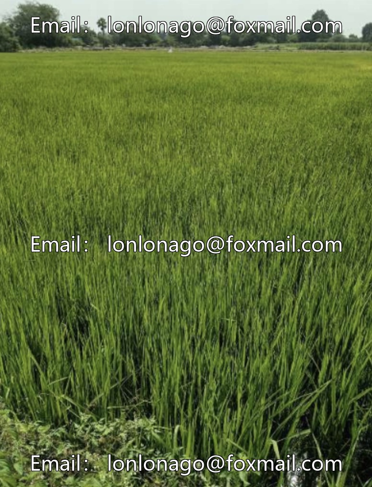
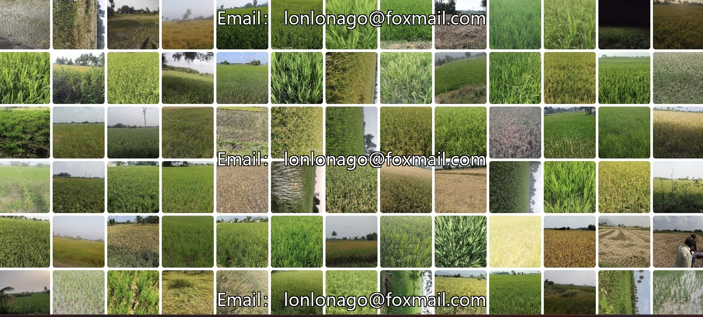
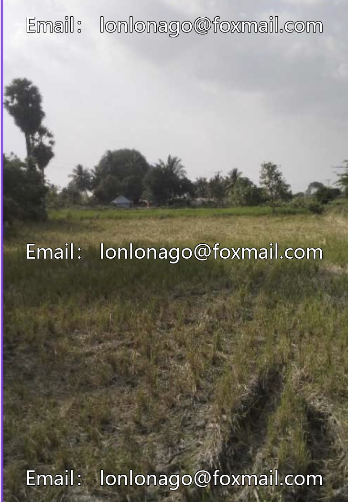
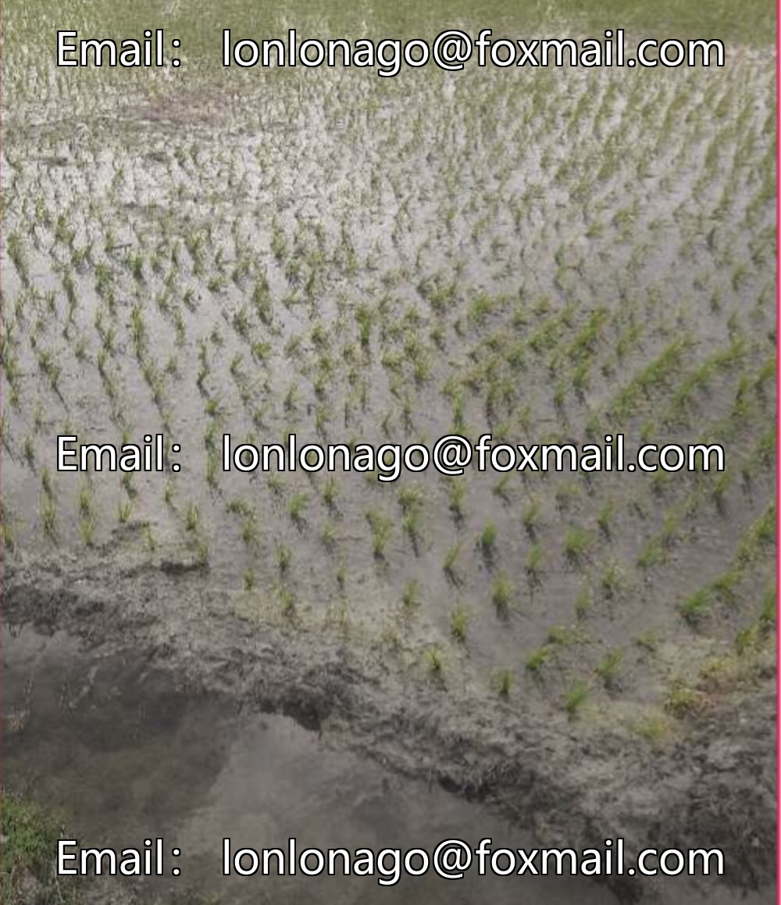

# Intelligent Agriculture Rice Growth Stage Classification Recognition Dataset, based on deep learning, containing 140

## Body

Intelligent Agriculture Rice Growth Stage Classification Recognition Dataset, based on deep learning, comprising over 1400 high-quality images, covering five rice growth stages (cleaning, first stage, second stage, third stage, fourth stage), suitable for automated crop health monitoring, precise fertilization and irrigation, pest and disease early warning in agricultural intelligent applications.

The dataset has been labeled, adopting YOLO format, and supports the training of mainstream object detection models, enhancing the generalization capability of the model in agricultural environments. The sample covers the entire life cycle of rice, with diverse light conditions and complex farmland backgrounds, and the distribution of categories is balanced.

Virtual materials, once sold, are non-refundable.
Interested friends, click "I want" to proceed.

## Images

## Payment

Here is a pay link on Stripe ( https://buy.stripe.com/3cs8yP7sY87d0vu9AB ). Please contact me lonlonago@foxmail.com after funding $89, and I will send you a complete data files , thank you!

